### 개요

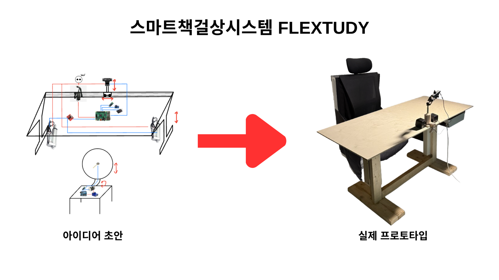

<div style="display:flex; gap:12px; background:rgba(135,131,120,0.15); padding:16px 20px; border-radius:8px; margin:16px 0;">
<div>❓</div>
<div markdown="1" style="flex:1; min-width:0;">

FLEXTUDY란?<br>
사용자의 나쁜 학습 자세들을 감지하고 교정해주는 학습보조 스마트데스크 시스템.<br>
책상과 의자로 구성되어있으며, 기존 모션데스크에 컴퓨터비전기반의 지능을 추가하고 책상과 연동되어 작동하는 의자가 조합된 시스템.<br>
기술적 우수성을 인정받아 제 6회 특허콘서트에서 입상함.

</div>
</div>

<div style="display:flex; gap:12px; background:rgba(135,131,120,0.15); padding:16px 20px; border-radius:8px; margin:16px 0;">
<div>💡</div>
<div markdown="1" style="flex:1; min-width:0;">

홍보영상: <https://www.youtube.com/watch?v=j7272pe8qn4><br>
Github: <https://github.com/jinoogi/FLEXTUDY>

</div>
</div>

<iframe src="https://www.youtube.com/embed/j7272pe8qn4" style="width:100%; aspect-ratio:16/9; border:0;" allowfullscreen></iframe>

| **영역** | **내용** |
| --- | --- |
| 비전 AI | MediaPipe FaceMesh·BlazePose·BlazeFace로 얼굴·전신 키포인트 추정.<br>엣지디바이스 Raspberry Pi에서 추론. |
| 판정 알고리즘 | 키포인트 좌표로부터 졸음, 다리 꼬기, 턱 괴기 판정 로직 직접 설계 |
| 센서 | 웹캠, 카메라모듈, 좌석 압력센서 |
| 전장 | 회로·모터 드라이버·배선 |
| 구동 | 책상: 리니어 액추에이터, 의자: 감속모터 |
| 통합 제어 | Raspberry Pi(주 제어) – Arduino(모터 제어) 연동, 블루투스 통신 |
| 웹 | 클라우드 기반 학습 통계 웹 보고서·피드백 시스템 |

### 라즈베리파이 세팅

**무선네트워크 설정 직접수정**

<figure style="width:80%; margin:0 auto;">
  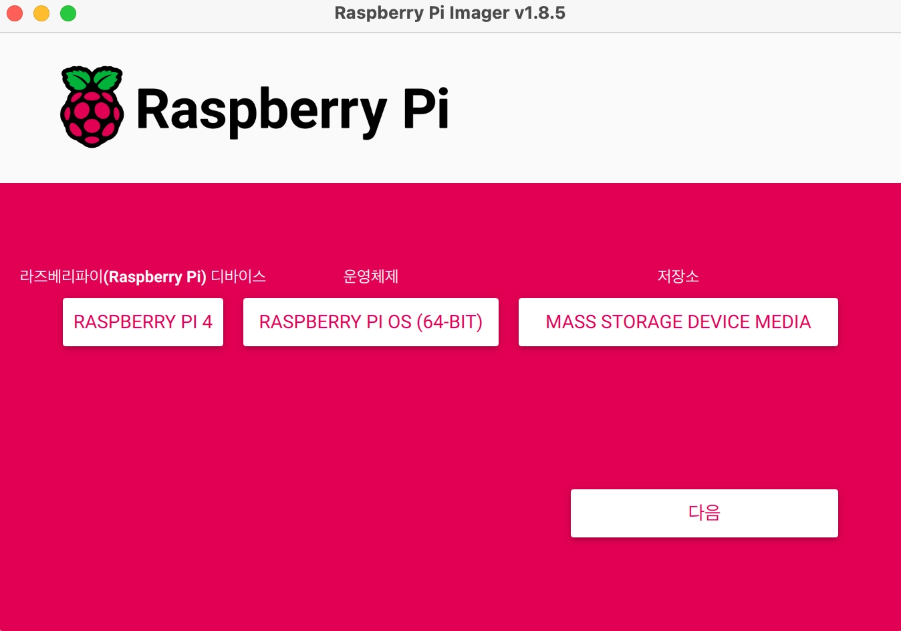
</figure>

마이크로 HDMI 젠더가 없어 라즈베리파이를 직접적으로 조작할수 없는상태에서, OS 재설치 없이 무선네트워크 설정을 변경하려는 방법을 찾다가 sd카드의 wpa_supplicant.config 를 직접 수정하는 방법을 찾았다.

```
country=US
ctrl_interface=DIR=/var/run/wpa_supplicant GROUP=netdev
update_config=1
network={
    ssid="WIFI 이름"
    psk="WIFI 비밀번호"
    scan_ssid=1
}
```

이렇게 wpa_supplicant.config 를 수정(ext4형식의 파일을 열수있는 리눅스 계열 PC로)해 와이파이 설정을 변경하려했으나, 아무리해도 작동하지 않았다….

지금에서야 알게되었지만, OS가 Bullseye에서 Bookworm으로 바뀌면서 설정방식이 바뀌었다고 한다.
저건 Bullseye 버전의 OS에서 설정하는 방식이었고, 지금 사용하는 OS인 Bookworm버전에서는 NetworkManager/system-connections/ 디렉토리의 연결파일을 수정해야 실제 와이파이 설정이 변경된다고 한다.

**유선연결 설정**

<div style="display:flex; gap:12px; align-items:flex-start;">
  <figure style="width:49%; margin:0;">
    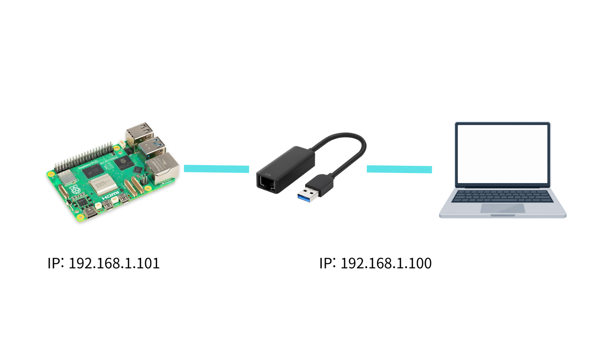
  </figure>
  <figure style="width:49%; margin:0;">
    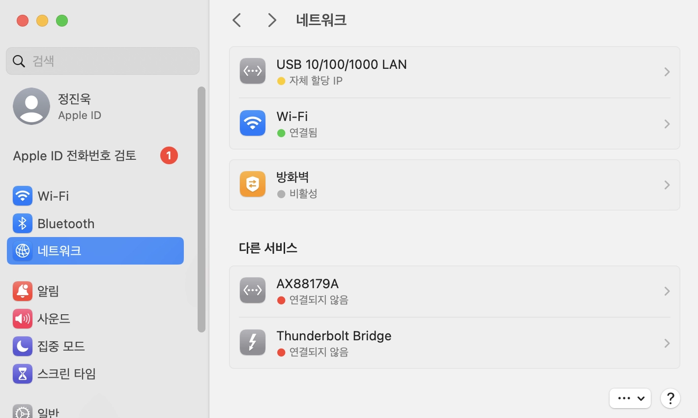
  </figure>
</div>

그리고 라즈베리파이와 맥북 유선연결도 설정해줘야한다.
맥북은 유선랜 NIC이 없어 랜카드를 사용해야했다.
실제로 제품을 제어할 때 와이파이가 없는 바깥에서 접속해야할 경우가 많으므로, 맥북과 라즈베리파이를 유선네트워크로 연결할 수 있게 유선랜으로 연결하고, 같은 서브넷에 들어가도록 고정 IP `192.168.1.100`, `192.168.1.101` 부여.

### 모델탐색

| 모델 | 구조 | 파라미터 | 연산량(FLOPs) | 엣지 컴퓨팅 |
| --- | --- | --- | --- | --- |
| dlib (머신러닝) | HOG + 선형 SVM+트리 앙상블 | - | 0.002 GFLOPs | ✅ |
| PoseNet | MobileNetV1 또는 ResNet50 백본 | 23M | 18 GFLOPs | ❌ |
| MoveNet Lightning | MobileNetV2 + FPN, CenterNet 계열 | 2.33M | 1.08 GFLOPs | ✅ |
| Mediapipe BlazeFace | SSD 계열 단일 단계 검출기, BlazeBlock | 0.1M | 0.06 GFLOPs | ✅ |
| Mediapipe FaceMesh | 경량 잔차(residual) CNN | 1.18M | 0.09 GFLOPs | ✅ |
| Mediapipe BlazePose | 검출기 + 랜드마크 CNN | 3.17M | 0.77 GFLOPs | ✅ |
| OpenPose | VGG 기반 | 52.3M | 272 GFLOPs | ❌ |

당시 우리 시스템에서 가장 기술적으로 중요했던부분이, 라즈베리파이라는 범용 cpu만 있는 장치에서 가속기 없이 돌아갈지였음. 
Coral같은 외부 npu를 사용하는방법도 고려했지만, 예산과 기술적인 어려움을 고려했을때 최대한 피해야할 선택지였고, 후보로 이렇게 7가지정도의 모델안면모델과 포즈모델들을 추려 하나씩 직접 돌려보면서 라즈베리파이에서 추론이 가능한지 경험적으로 판정했음.

당시에는 AI에 대한 깊이가 부족해 정확히 이해하지 못했지만, 이해도가 생긴 지금에서야 보면 dlib은 우선 신경망모델이 아닌 고전 머신러닝 파이프라인이었고, 나머지 6개 후보들은 모두 CNN 아키텍쳐라서 모델 크기보다도 연산량이 실질적인 병목이었다.
라즈베리파이의 연산량은 신경망 추론시 6 GFLOPs 정도인데, 당시 OpenPose와 PoseNet을 쓸수 없었던 이유가 이것때문이었음.

### 졸음감지기능 구현

**졸음감지**

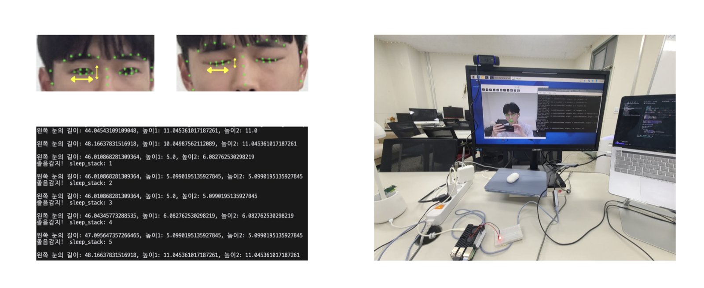

Dlib으로 포인트를 추론하고, 눈의 가로길이와 세로길이 비율로 졸음을 판단하는 알고리즘 구현.
눈 깜빡임이나 각종 노이즈에 흔들리지 않도록 연속 n회 이상 눈이 감겨야 졸음으로 판단하도록 함.

**책상 액추에이터 제어**

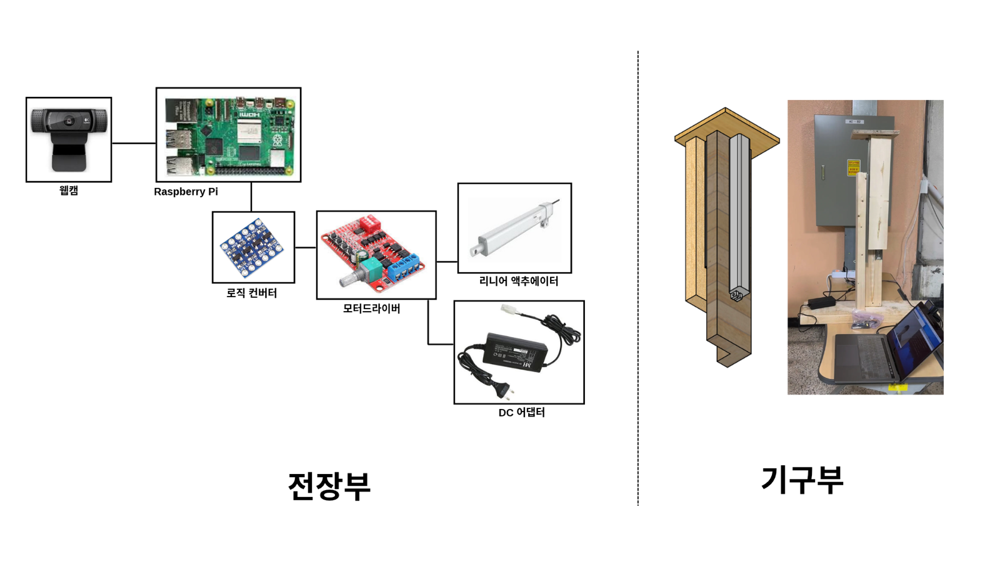

졸음감지 시 라즈베리파이가 모터드라이버를 통해 리니어 액추에이터를 구동시킬 수 있도록 배선을 구성했는데, 처음에는 로직컨버터 없이 바로 모터드라이버와 라즈베리파이 GPIO를 연결함.

액추에이터가 이상하게 작동하는 문제가 있어서 찾아보니 라즈베리파이의 GPIO는 3.3V인데 반해 모터드라이버는 5V의 로직신호를 필요로해서, 중간에 로직 컨버터로 신호를 승압시켜야 했음.

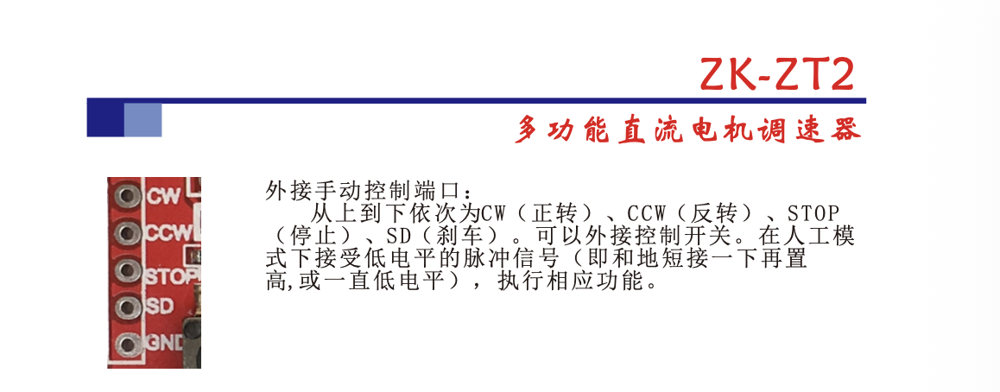

그런데 로직 컨버터 사용후에도 여전히 이상한타이밍에 액추에이터가 작동했음.
ZK-ZT2 드라이버의 기술시트를 찾아 사용법을 확인하니, high → low 신호에 반응하는 active low 구조였음. 
LED로 신호테스트할때부터 당연히 high 신호에 반응할거라고 생각하고 코드를 구현했는데, 여러 시스템이 얽혀있어서 반대상황에서 작동하더라도 원인을 찾기가 까다로웠음…

### 자세감지기능 구현

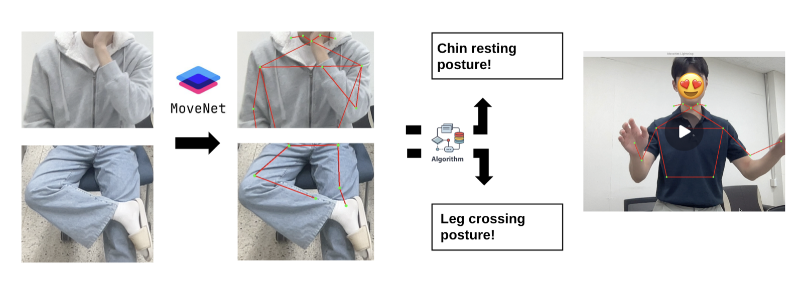

**다리꼬기 감지**

다리꼬기 감지기능은 MoveNet으로 포인트를 추론하고, CCW 알고리즘으로 선분이 교차하는지 확인하는 방식으로 알고리즘을 구현했음.
처음에는 상체와 하체를 따로 촬영하고 추론도 따로 수행했는데, 이렇게 하니 하체의 인식률이 떨어지는 문제가 있어 상체와 하체프레임을 합쳐 한번에 추론하는방식으로 수정했음.

**턱괴기 감지**

턱괴기는 손 포인트와 머리 포인트가 일정수준이상 가까워진채로 유지되는지 확인하는방식으로 구현했음.
그런데 턱괴기를 판정하는 기준 거리가 예민해서 상대적인 거리에 민감도가 많이 달라지는 문제가 있었고, 쇄골길이를 기준으로 한 상대적인 길이를 사용하는방식으로 수정함.

### 감지기능 디버깅

구현한 기능들을 여러 상황에서 테스트해보니 감지기능들이 실제로 사용하기 어려울만큼 감지성능이 떨어졌음.
그래서 더 정확한 모델을 찾던중, Mediapipe 프레임워크의 facemesh 와 blazepose 모델의 성능이 훨씬 뛰어나 전체적인 추론모델들을 Mediapipe 프레임워크 모델들로 전부 대체함.

**졸음감지 모델**

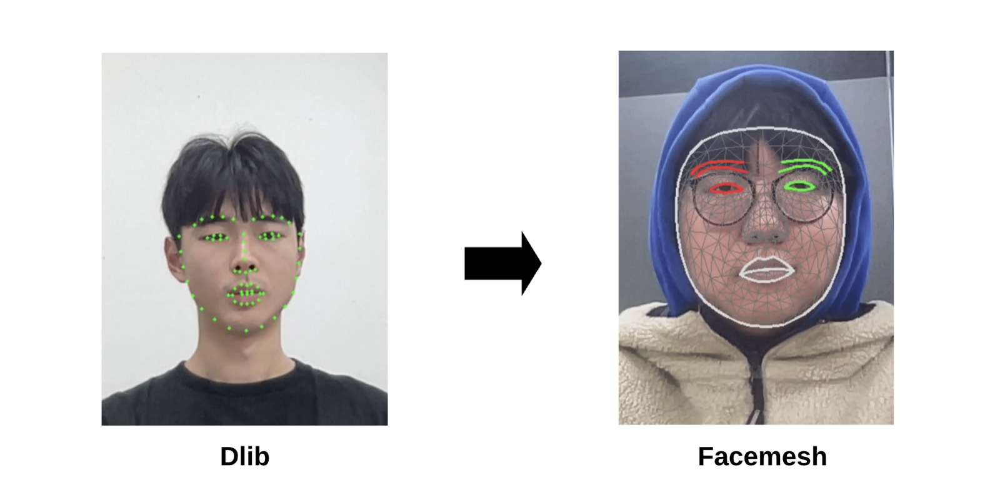

먼저, Blazeface 모델을 통해 안면부를 감지하고, bounding box 영역을 crop해 확대하는방식으로 스테이지를 2단계로 나누었음.
포인트 추론에서는 Facemesh 모델로 변경하고나서 다양한 위치와 각도에서 강건하게 포인트들을 추론할 수 있게 되었고, 특히 움직이고있거나 안경을 쓰고있는경우에도 정확한 눈감김 감지가 가능해졌다.

기존에는 3분에 한번씩 오탐이 발생하던 기능이, 이후에는 1시간동안 사용해도 오탐이 발생하지 않고 실제 사용이 가능한수준으로 성능이 개선됨.

**다리꼬기감지 모델**

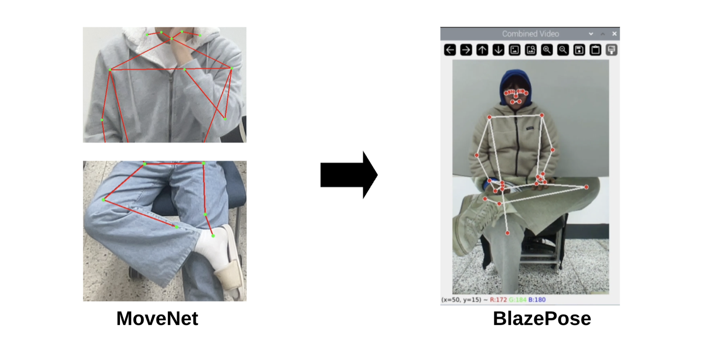

기존의 Movenet은 정확도도 좋지 못했지만, 커버하는 포인트수가 적고 특히 카메라에 하체가 다 들어오지않고 일부 잘리는경우에 억지로 모든 포인트를 추론해서 오직이 꼬이는경우가 많았음.
그런데 Blazepose는 발이나 손같은 말단부위 포인트도 추론이 가능하고, 특히 카메라에 사람이 다 들어오지 않더라도 없는부위는 추론하지 않고 보이는부위만 정확히 추론해 대부분의 오탐문제가 해결됨.

**턱괴기 감지**

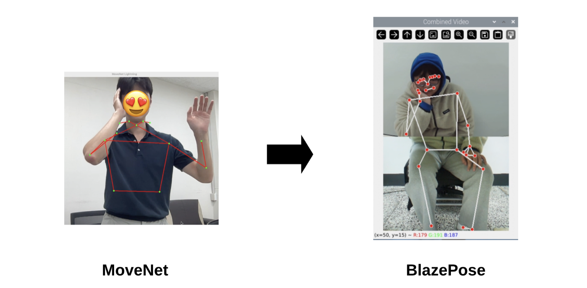

턱괴기 감지는 원래 정밀한 감지를 위해 Mediapipe hands 모델로 손 포인트들을 따로 추론하고 facemesh 에서의 턱선과 접촉여부를 탐지하는 알고리즘으로 업그레이드하려고 했으나, 일반적인 자세와 다르게 턱을 괴는경우에는 손이 얼굴에 가려지는경우가 많아 손 탐지가 불안정해지는 문제를 발견했음.

그에 반해 Blazepose 에서도 손 포인트들을 탐지하는데, 전신 키포인트들을 함께 추론하기 때문에 전신의 맥락을 보고 손이 얼굴에 가려져있어도 강건하게 추론하는것을 확인했음.
그래서 턱괴기 감지도 Blazepose로 포인트들을 추론하는방식으로 변경함.

### 기대앉기 감지기능 구현 및 의자구현

**기대앉기 감지**

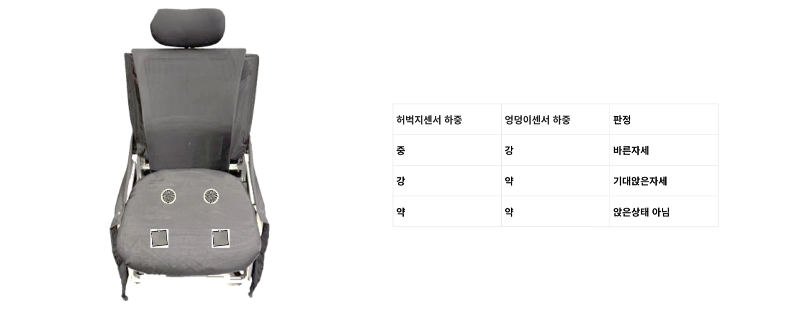

원래 계획은 압력센서를 앞에 2개, 뒤에 2개씩 배치해 허벅지와 엉덩이의 압력분포를 이용해서 눕듯이 비스듬하게 앉은 자세를 판별하려고했음.
그러나 실제 테스트결과, 엉덩이부분의 센서는 의도한대로 안정적으로 작동했던데에 반해 허벅지부분의 센서는 의도한 상황에서도 안정적으로 작동하지 않았음.
따라서 안정적으로 사용할수있는 엉덩이부분의 압력만으로 기대앉기 감지 기능을 구현했음.

**의자구동**

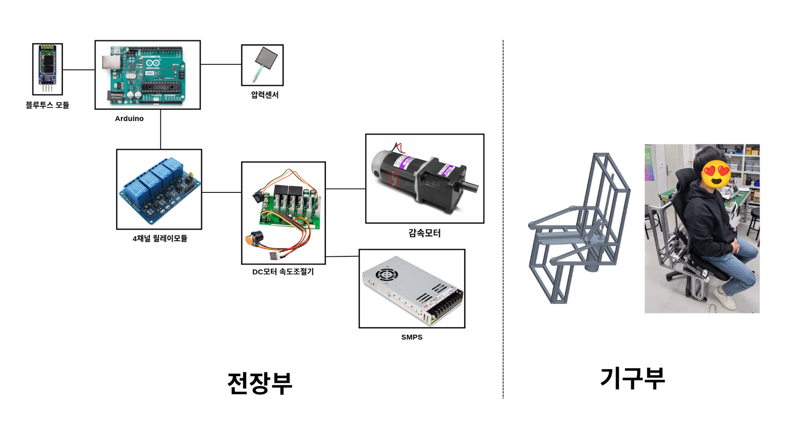

의자는 리드스크루로 사람이 앉아있는상태에서 좌석을 위로 올리기때문에 강한 힘이 필요해 고출력 감속모터를 사용했고, 전장모듈의 용량도 더 커져야 했음.

### 스위치 구현

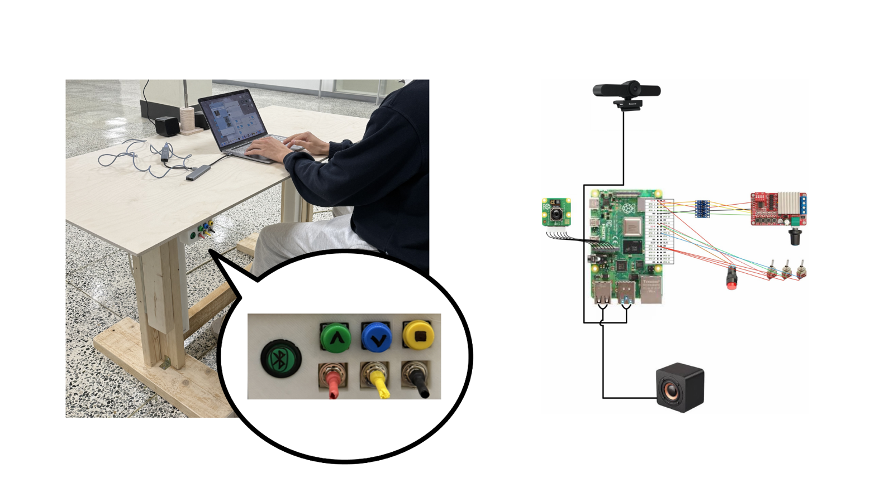

스마트책걸상의 각종 기능을 선택적으로 사용할 수 있도록 토글스위치와 의자 연결버튼을 구현함.
비동기적인 기능 사용상태는 스위치와 버튼에 연결된 GPIO핀 상태를 읽는 콜백함수를 등록함으로서 구현했고, 메인 제어루프에서 각 기능의 상태를 확인하고 기능을 수행하는방식으로 코드를 수정함.

### 시스템 통합

**카메라 버퍼로 인한 프레임 지연**

```
while True:
    이미지 추출 (상체, 하체)
    졸음 판정 
    턱괴기 판정 
    다리꼬기 판정
    기대앉음 판정
    time.sleep(n)
```

이제 동기적으로 제어루프가 돌도록 각 기능들을 통합했음.
그런데 여러 서브시스템들을 통합하니 예상치못한 문제들이 발생하기 시작했음.

먼저 웹캠은 30FPS로 이미지를 받아서 드라이버 버퍼에 쌓는데, 루프 한번을 도는데 걸리는 시간이 길어지니 버퍼에 쌓인 이미지를 뽑아서 쓰는 속도도 느려지면서 이미지가 쌓이기 시작했음.
버퍼가 차면 기본적으로 새로들어오는 이미지들이 버려지기때문에, 이미지 버퍼 크기를 1로 설정해 지연을 최소화하더라도 제어루프가 1번 도는시간에 해당하는 지연이 발생했음.
따라서 버퍼에 쌓는 방식이 아닌 최신 이미지에 직접 접근하도록 imutils 라이브러리의 VideoStream를 사용함.

**USB 2.0 대역폭문제**

```bash
/:  Bus 02.Port 1: Dev 1, Class=root_hub, Driver=xhci_hcd/4p, 5000M
/:  Bus 01.Port 1: Dev 1, Class=root_hub, Driver=xhci_hcd/1p, 480M
    |__ Port 1: Dev 2, If 0, Class=Hub, Driver=hub/4p, 480M
        |__ Port 1: Dev 35, If 2, Class=Audio, Driver=snd-usb-audio, 480M
        |__ Port 1: Dev 35, If 0, Class=Video, Driver=uvcvideo, 480M
        |__ Port 1: Dev 35, If 3, Class=Audio, Driver=snd-usb-audio, 480M
        |__ Port 1: Dev 35, If 1, Class=Video, Driver=uvcvideo, 480M
        |__ Port 3: Dev 39, If 0, Class=Video, Driver=uvcvideo, 480M
        |__ Port 3: Dev 39, If 1, Class=Video, Driver=uvcvideo, 480M
        |__ Port 3: Dev 39, If 2, Class=Audio, Driver=snd-usb-audio, 480M
        |__ Port 3: Dev 39, If 3, Class=Audio, Driver=snd-usb-audio, 480M
```

그렇게 실시간 이미지를 사용하도록 문제를 해결했는데, 이번엔 대역폭문제가 발생함.
개발용 맥북에서 웹캠 2대를 사용할때는 포트별로 별도의 System bus를 사용했음.
그런데 라즈베리파이4는 usb2.0 장치라면 동일한 System bus를 사용하는바람에, usb2.0 웹캠 2대를 동시에 처리할수 없었음.
그래서 `v4l2-ctl` 로 드라이버수준에서 대역폭을 낮춰보려고 했으나, 웹캠은 대역폭 최대치예약을 걸어버리는방식이라 해결이 안됨.

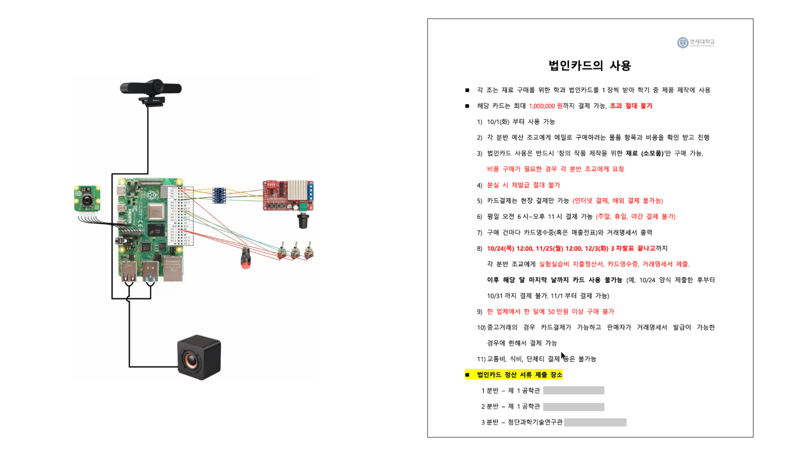

```bash
USB 웹캠
  웹캠 ─ USB 케이블 ─▶ [VL805 USB 컨트롤러]─ PCIe 1차선─▶ ──┐
                                                      │
CSI 카메라 모듈                                   [BCM2711 칩 내부 버스] ─▶ [RAM]
  센서 ─ CSI-2 리본 케이블 ─▶ [칩 안의 CSI 수신기] ──────────┘       (LPDDR4, 12.8GB/s)
```

충분한 bus 대역폭을 이용할수 있는 usb3.0 웹캠을 사용하거나 usb bus를 거치지 않는 별도의 카메라모듈을 사용해야했는데, usb3.0 웹캠은 가격이 비싸 예산상의 문제가 있었고, 별도의 카메라모듈을 사용해 하체촬영용 웹캠을 대체했음.

**휴식 시 의자 오작동 문제**

의자를 통합하고 여러 상황에서 테스트해보니, 사람이 자리를 떠나면 기대어 앉아있는것으로 판단하고 의자가 작동하는 문제가 있었음.
원인은 센서가 엉덩이 2개로 줄어 사람이 자리를 떠난것을 감지할수있는 로직이 없는것이었음.

이를 보완하기위해 loadcell같은 다른 센서를 이용해 의자 자체에 걸리는 무게를 측정하는 방법도 고려해보았으나, 책상의 비전을 활용해 사람이 인식될때만 기대어앉은 자세를 검사하도록 알고리즘을 수정했음.
기존의 의자에서 센싱하고 판단하고 작동하던 방식에서, 의자는 압력센서의 값을 책상의 주 제어기에 전송하고 주 제어기에서 컴퓨터비전과 함께 기대어앉음 여부를 판단한 후 작동여부를 다시 송신하는방식으로 제어로직을 주 제어기가 모두 관리하도록 아키텍쳐가 수정됨.

**릴레이 구동 시 제어기 리셋 문제**

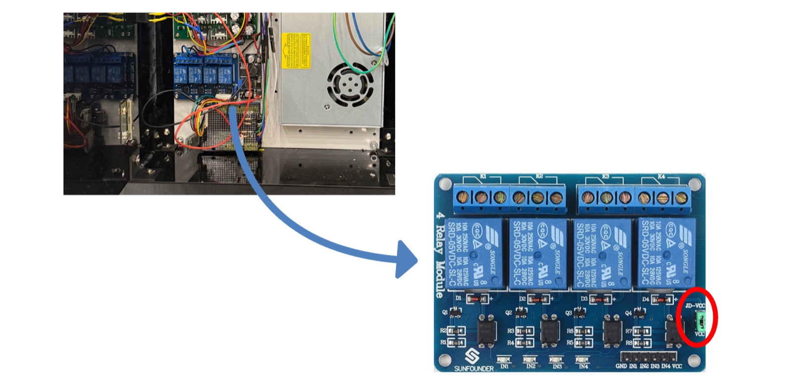

최종 시험에서, 졸음이나 기대어앉은 상황에 갑자기 의자의 제어가 멈춰버리는 문제가 발생했음.
처음에는 메인 제어로직의 문제이거나 블루투스 통신문제를 의심해서 의자 제어기 로그를 모니터링해봤는데, 블루투스나 코드에서 끊김이 생기는것이 아니라 아예 전원이 꺼지고있었음.

쉽게 원인추정이 안되서 반복해서 상황을 재현하고 실험해보니, 제어기 전원이 꺼지기전 매번 “딸깍” 하는소리가 들렸음.
그래서 릴레이모듈을 의심하고 기술유튜브를 보면서 모듈의 구조를 이해하던중, JD-VCC 와 VCC 가 각각 릴레이 코일 전원과 입력전원이고, 금속캡이 씌워져있으면 둘의 전원이 공유된다는 사실을 알아냄.

캡을 뽑아 JD-VCC, VCC를 분리하고, 코일은 별도의 전원을 넣어준상태로 실험하니 이번에는 문제없이 어떤상황에서도 의자의 제어가 의도한대로 안정적으로 이루어짐.
