### 개요

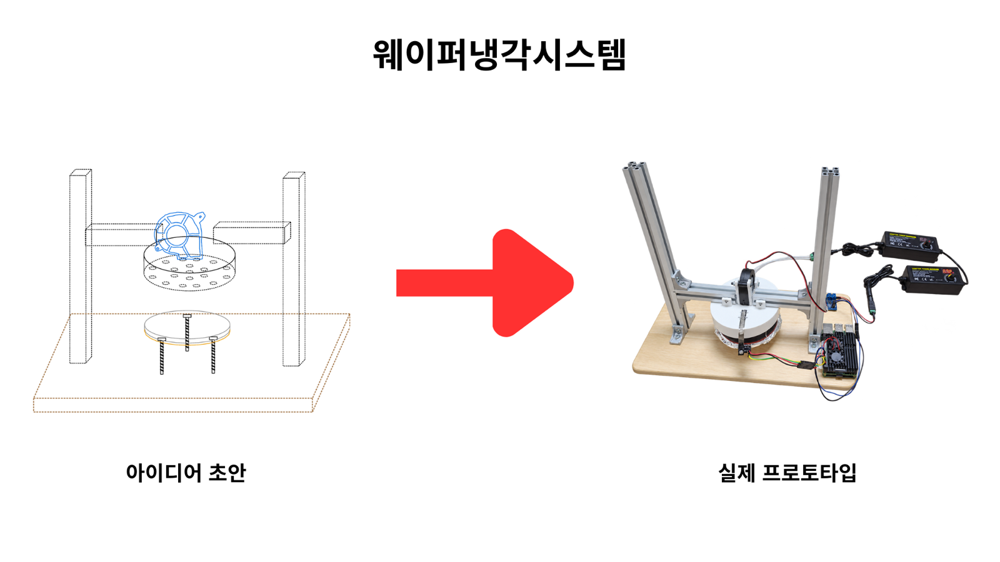

<div style="display:flex; gap:12px; background:rgba(135,131,120,0.15); padding:16px 20px; border-radius:8px; margin:16px 0;">
<div>❓</div>
<div markdown="1" style="flex:1; min-width:0;">

웨이퍼냉각시스템:<br>
웨이퍼 모사체(SUS304)를 목표온도로 유지하는 지능형 온도조절시스템.<br>
공기 강제대류방식으로 냉각하며, LLM기반의 운전결과 분석 어시스턴트 및 웹 기반 원격운전 모니터링기능이 구현되어있음.

</div>
</div>

<div style="display:flex; gap:12px; background:rgba(135,131,120,0.15); padding:16px 20px; border-radius:8px; margin:16px 0;">
<div>💡</div>
<div markdown="1" style="flex:1; min-width:0;">

시연영상: <https://www.youtube.com/watch?v=PR-1jVp4s7c&list=PLd-W1gzIn6Bs&index=6><br>
Github: <https://github.com/jinoogi/wafer_cooling_system>

</div>
</div>

<iframe src="https://www.youtube.com/embed/PR-1jVp4s7c" style="width:100%; aspect-ratio:16/9; border:0;" allowfullscreen></iframe>

---

### 열유체 해석기반 설계

**해석 초기시도**

<div style="display:flex; gap:12px; align-items:flex-start;">
  <figure style="width:49%; margin:0;">
    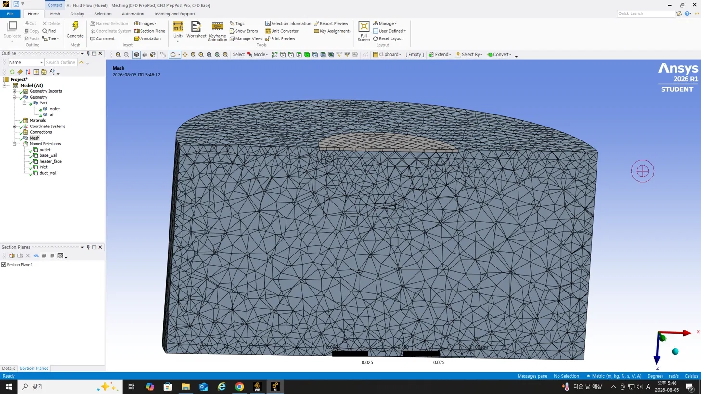
  </figure>
  <figure style="width:49%; margin:0;">
    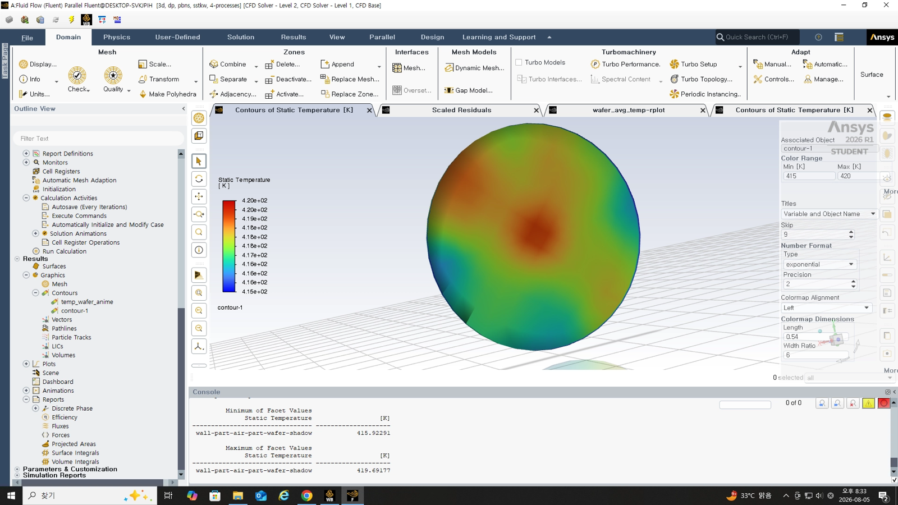
  </figure>
</div>

이렇게 일반적인 meshing을 하고 해석했더니 매우 조악하고 부정확한 결과가 나왔음.

<div style="display:flex; gap:12px; align-items:flex-start;">
  <figure style="width:49%; margin:0;">
    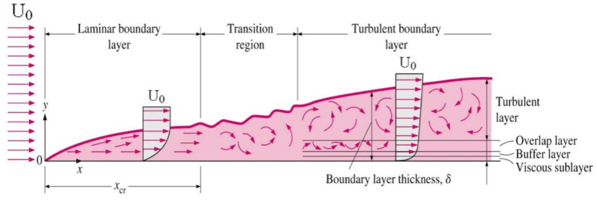
  </figure>
  <figure style="width:49%; margin:0;">
    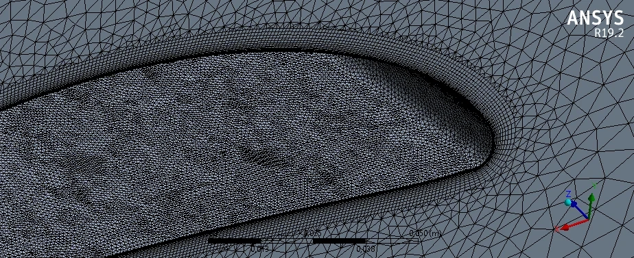
  </figure>
</div>

유체유동에서는 대상 물체와 유체 사이의 경계층이 발생하는데, 이 경계층이 열전달에 절대적인 영향을 미침.
따라서 이 경계층을 제대로 모델링해야 정확한 열유체해석이 가능한데, 문제는 이 경계층 두께가 매우 미소함.
이럴때 inflation을 사용하면 경계층을 제대로 표현할 수 있음.

<figure style="width:80%; margin:0 auto;">
  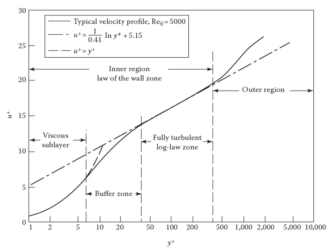
</figure>

그런데 inflation 으로 mesh만 경계층에 맞춰준다고 끝나는것은 아님.
$$y+>30$$ 인 구간에서는 판에 평행하게 완전발달한 유동을 가정한 상태에서 구해진 실험식인 벽함수를 사용할 수 있는데, k-ω 솔버는 똑똑하게 $$y+$$ 값을 보고 지가 알아서 벽함수를 사용할지 말지 판단함.
가령 $$y+$$ 가 3이면 그냥 아무 실험식이나 가정이 들어가지 않은 보편적물리법칙에 따라 $$u+ = y+$$ 로 계산하지만, 70이 나오면 벽함수를 사용해 빠르게 벽면속도 $$u_\tau$$ 를 계산함. 

근데 문제는 우리는 판에 제트가 수직으로 박히는 형상이라 벽함수를 사용해선 안되는 조건임.
따라서 마진을 고려해 $$y+ \approx 1$$ 로 맞춰줘야 $$u+ = y+$$ 로 계산이 들어가고, 이걸 맞춰주기위해 첫 셀의 $$y$$ 값을 수동으로 설정해주는 옵션이 First Layer Height 임.

**경계층 inflation 해석**

<div style="display:flex; gap:12px; align-items:flex-start;">
  <figure style="width:49%; margin:0;">
    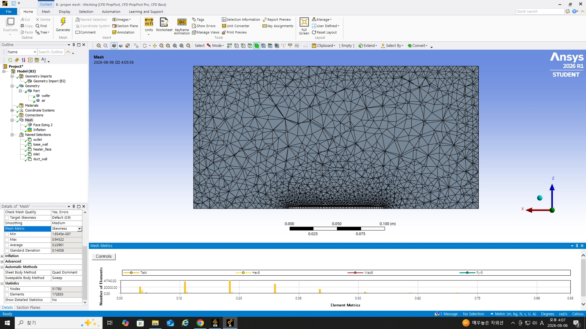
  </figure>
  <figure style="width:49%; margin:0;">
    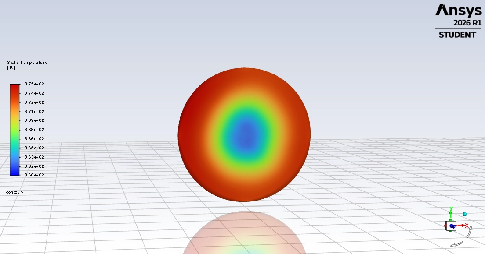
  </figure>
</div>

<div style="display:flex; gap:12px; background:rgba(135,131,120,0.15); padding:16px 20px; border-radius:8px; margin:16px 0;">
<div>💡</div>
<div markdown="1" style="flex:1; min-width:0;">

웨이퍼 두께: 1mm, 웨이퍼 열전도율: k=16.7, inlet velocity: 5.4m/s, heat flux: 31W<br>
min: 357.08K<br>
max: 378.65K<br>
avg: 372.15K<br>
σ: 5.82K

</div>
</div>

그렇게 해석 진행해서 훨씬 해상도 높고 설명력있는 해석결과를 얻음.
그런데 중앙에 제트가 집중되는 현재 디자인에서는 원의 바깥과 중심의 온도불균일이 크게 발생하는것을 확인.
이렇게되면 공정이 불균일해지고 판이 변형될 우려가 있으므로, 냉각시스템의 구조를 수정함

**인젝터 설계, 해석**

<div style="display:flex; gap:12px; align-items:flex-start;">
  <figure style="width:49%; margin:0;">
    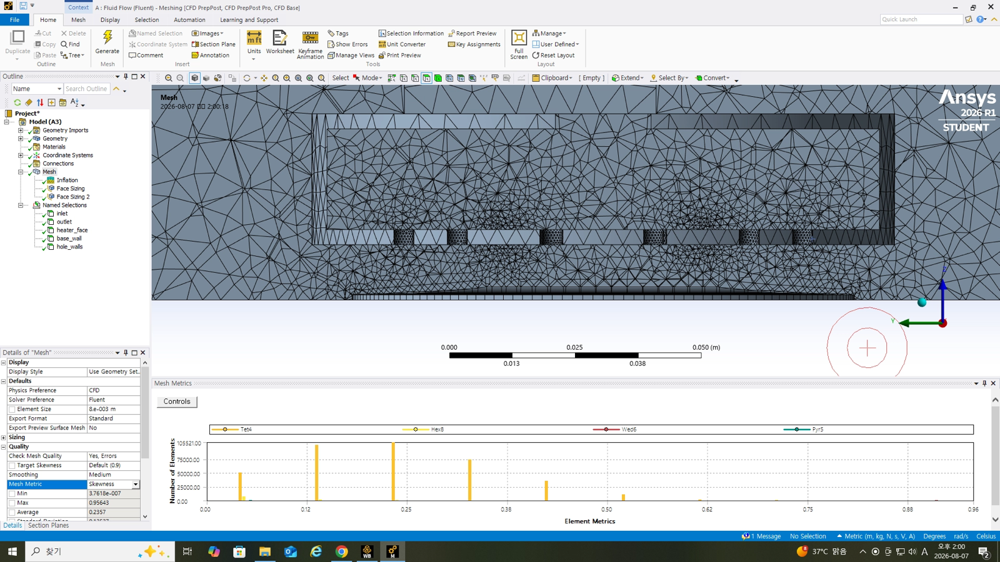
  </figure>
  <figure style="width:49%; margin:0;">
    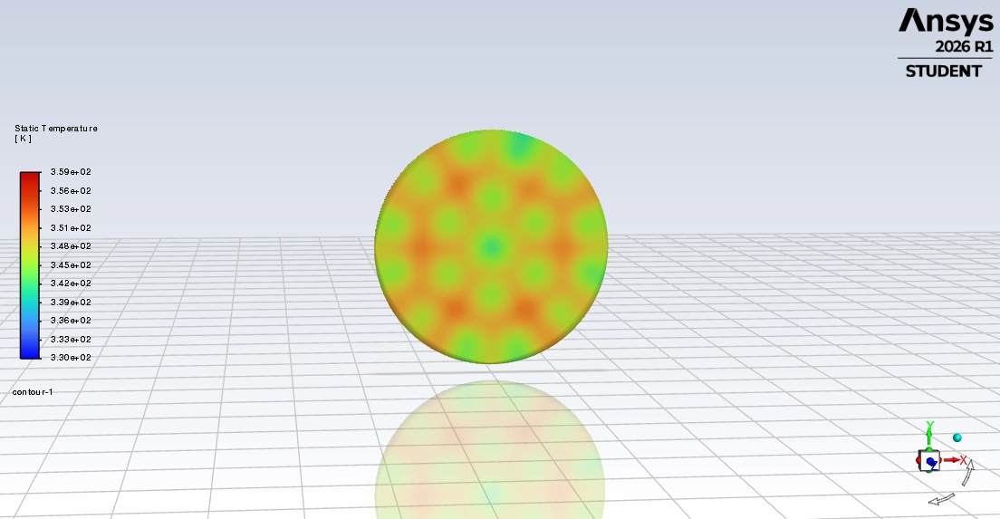
  </figure>
</div>

<div style="display:flex; gap:12px; background:rgba(135,131,120,0.15); padding:16px 20px; border-radius:8px; margin:16px 0;">
<div>💡</div>
<div markdown="1" style="flex:1; min-width:0;">

웨이퍼 두께: 1mm, 웨이퍼 열전도율: k=16.7, inlet velocity: 5.4m/s, heat flux: 31W<br>
min: 341.31K<br>
max: 351.95K<br>
avg: 347.59K<br>
σ: 1.98K

</div>
</div>

해석결과 이렇게 매우 균일도가 향상되는것을 확인하고, 인젝터 설계를 확정함.

**동작점 수정**

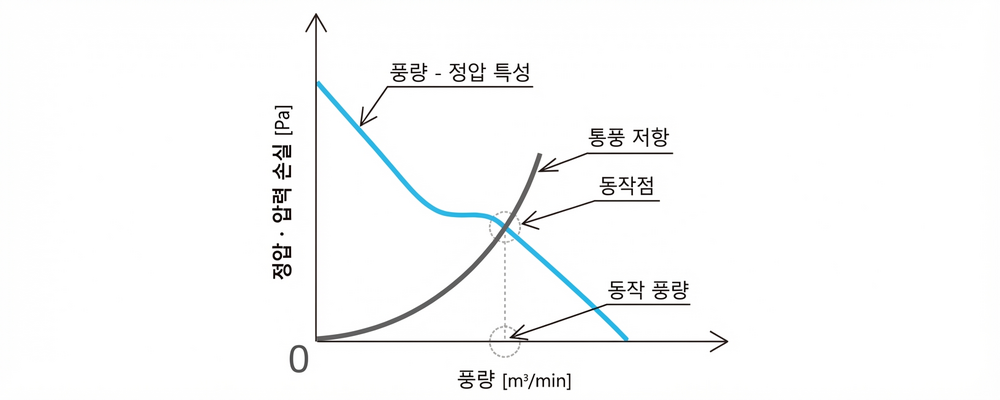

다음으로는 임의로 설정한 동작점을 계산하기 위해 해석결과를 바탕으로 시스템 저항곡선을 유도한 후 쿨러의 $$P-Q$$ 선도와의 교점을 계산함.

$$
\Delta P=kQ^2 \quad\text{where }\begin{cases} Q: (0.019m)(0.015m)(5.4m/s)=0.00154m^3/s \\ \Delta P: 62.6Pa 
\end{cases}
\\ \therefore k=2.643 \cdot 10^7 Pa\cdot s^2/m^6
$$

설계한 인젝터의 시스템 저항곡선의 식은 위와같고,

저가형 팬이라서 그런지 winsinn 5015의 P-Q선도가 제공되지 않아

<div style="display:flex; gap:12px; background:rgba(135,131,120,0.15); padding:16px 20px; border-radius:8px; margin:16px 0;">
<div>💡</div>
<div markdown="1" style="flex:1; min-width:0;">

최대정압: $$16.28mmH_2O=160Pa$$<br>
최대유량: $$3.23CFM=1.525 \cdot 10^{-3} m^3/s$$

</div>
</div>

위의 정보로 선형으로 근사모델링함.

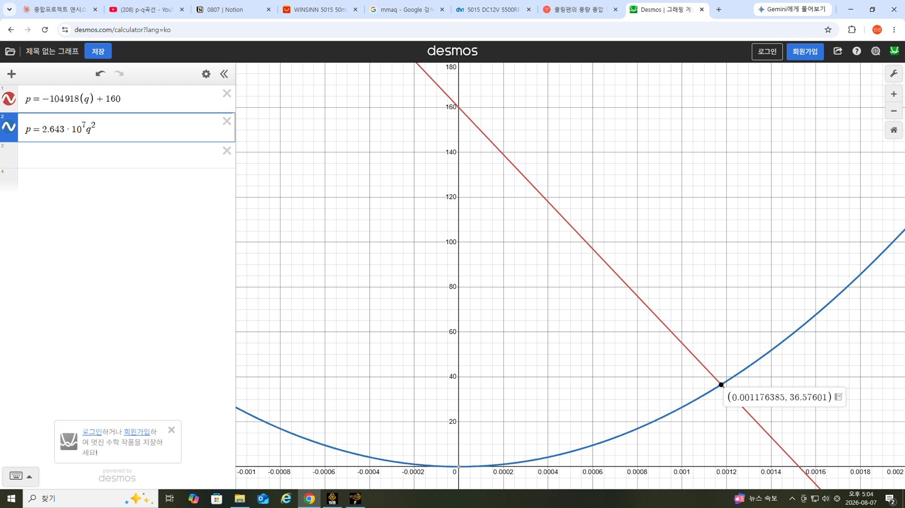

동작점을 계산한 결과 $$2.49CFM$$, 즉 경계조건이  $$V=4.13m/s$$ 로 수정되어야하는것을 확인.

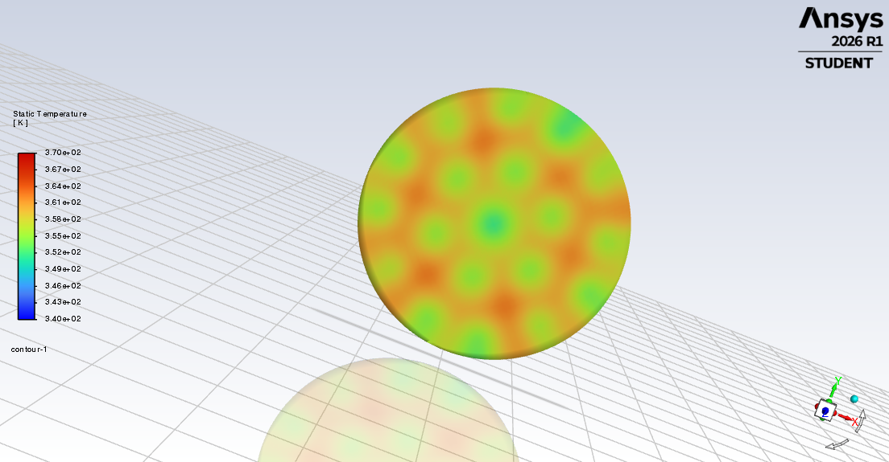

<div style="display:flex; gap:12px; background:rgba(135,131,120,0.15); padding:16px 20px; border-radius:8px; margin:16px 0;">
<div>💡</div>
<div markdown="1" style="flex:1; min-width:0;">

웨이퍼 두께: 1mm, 웨이퍼 열전도율: k=16.7, inlet velocity: 4.13m/s, heat flux: 31W<br>
min: 351.98K<br>
max: 362.48K<br>
avg: 358.21K<br>
σ: 2.01K

</div>
</div>

실제 동작점 정보로 다시 해석을 진행했을때의 결과는 위와같으며, 계산했을때와 마찬가지로 inlet pressure가 $$36.5Pa$$가 출력되어 동작점 시뮬레이션에 대한 신뢰도 검증도 완료됨.

---

### 하드웨어 제작

**인젝터 출력**

fluent의 injector geometry는 용도상 3d파일 export가 불가능해서 onshape로 다시 재설계 진행

<div style="display:flex; gap:12px; align-items:flex-start;">
  <figure style="width:49%; margin:0;">
    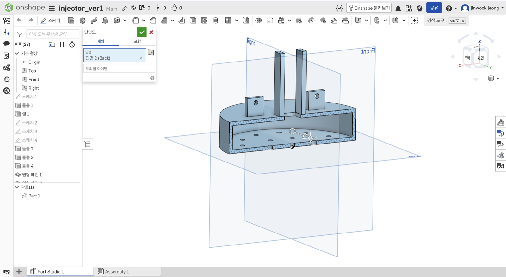
  </figure>
  <figure style="width:49%; margin:0;">
    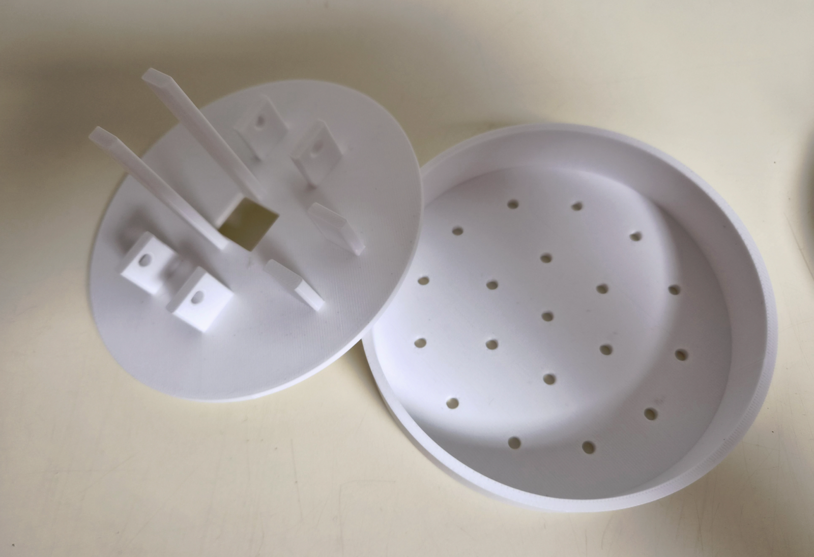
  </figure>
</div>

3d프린터 출력문제로 2개로 분리 후 접착제로 결합하는방식으로 진행했고, 소재는 내열성을 고려해 PETG 선택

**전장 구현**

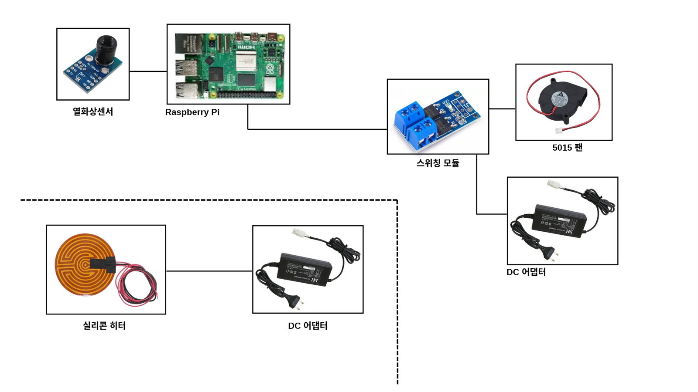

PWM 제어를 구현하기 위해 전자적으로 전류를 제어할수 있는 MOSFET 스위치 모듈을 사용함.

---

### PWM제어

쿨러를 PWM으로 제어해보니 duty=100일때는 잘 돌아가지만 0~99.99에서는 움찔거리기만 할 뿐 돌지않는 문제를 발견함.

**가설1: 스위칭모듈 MOSFET 충전지연**

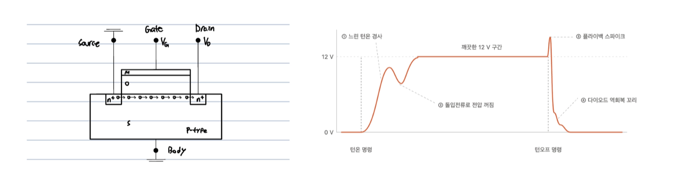

먼저 의심한 원인은 스위칭모듈이었음.

IRF520모듈은 스위칭기능을 수행하는 MOSFET 모듈임.
여기서 반도체공학의 MOSFET 구조를 생각해보면, 결국 O라는 절연층이 존재하는 일종의 커패시터구조이고, 따라서 gate에 전압을 인가해도 source-drain 채널에 캐리어가 찰때까지 응답시간지연이 필연적으로 발생함.
그래서 PWM으로 펄스전압을 gate에 인가하더라도 채널이 점진적으로 열리면서 채널저항이 줄어들기때문에 source-drain 채널과 연결된 팬에 걸리는 전압이 점진적으로 오르는 천이영역이 존재함.

결국 PWM의 제어주파수 $$25kHz$$에 비해 스위칭모듈의 MOSFET 채널 충전이 늦는것이 원인이라고 생각했고, 충전시간을 구하기위해 시정수를 계산해봄.

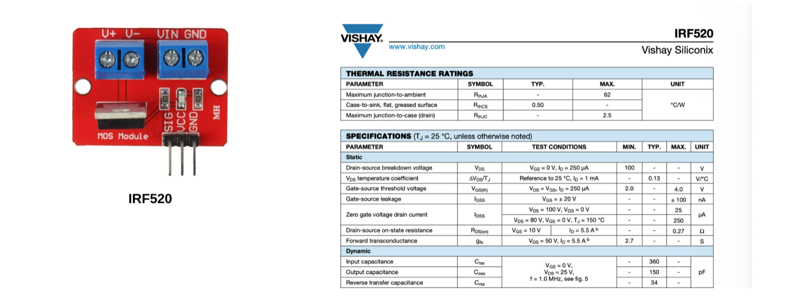

모듈의 MOSFET소자는 스펙시트를 찾아서 $$C_{iss}=360pF$$임을 확인했고, 저항은 멀티미터로 실측해서 $$1k \Omega$$ 임을 확인함.
그런데 계산해보니 $$\tau=RC_{iss}=1k\Omega\cdot 360pF=0.36\mu s$$ 었고, 실제 주기에서 비해 매우 작은시간이라서 이것때문에 팬이 돌지않는것은 설득력이 떨어졌고 가설 기각함.

**가설2: 게이트전압부족**

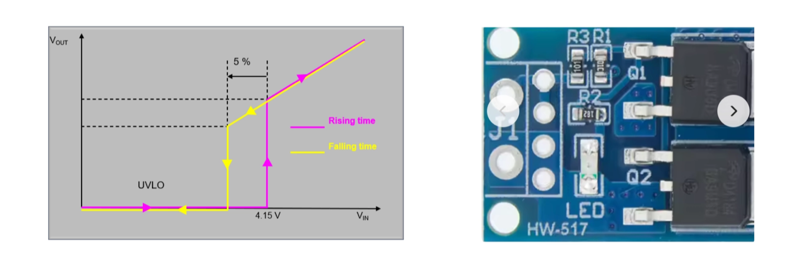

두번째 가설은 게이트전압 부족으로 인한 팬 IC칩 UVLO 차단이었음.

보통 팬에는 기준보다 낮은 전압이 들어올경우 아예 작동을 차단하는 UVLO기능이 있는경우가 많다고 했고, 
원래 쓰던 IRF520 모듈은 게이트작동전압으로 보통 5V를 받는데, 라즈베리파이는 3.3V를 로직신호로 사용하기때문에 게이트저항이 높아 팬에 걸리는 전압이 낮아지는 상황을 의심함.

그래서 3.3V를 게이트작동전압으로받는 D4184모듈로 교체하고 실험을 진행했는데, 여전히 동일한문제가 발생했기때문에 이 가설도 기각함.

**가설3: 팬 자체의 문제**

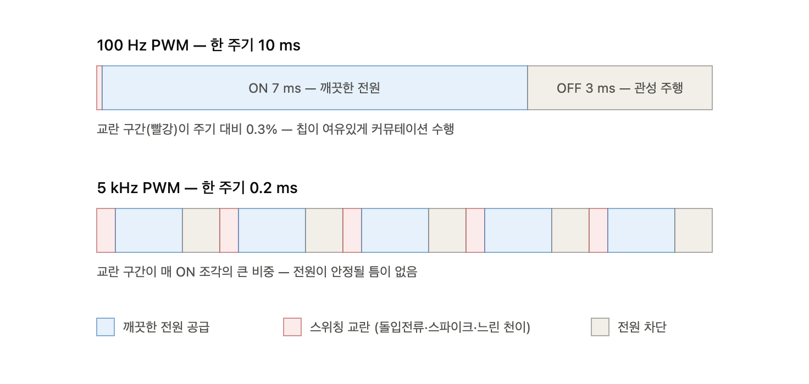

라즈베리파이의 GPIO핀에서 정상적으로 제어신호가 출력되는것을 확인했기때문에, 남은 후보는 스위칭모듈이 아닌 팬 자체에 문제가 있다는 것이었음.
지금 사용하는 5015 팬은 $$V_{in},GND$$ 만 있는 2선식 BLDC 팬인데, 모터에 들어가는 전력과 내부의 정류 IC에 들어가는 전력이 분리되어있지 않으므로 PWM 제어에서 IC까지 꺼지는것으로 추정됐음.
그래서 PWM 제어 주파수를 100Hz까지 낮춰보았는데 이번엔 팬이 제대로 작동했음.

만약 4선식 BLDC 였거나 브러시 DC 였으면 문제가 없었겠지만, 저가형 2선식 BLDC를 사용했고 그 특성탓에 발생했던 문제였음.

---

### 열화상센서

**센서 세팅**

```bash
dtparam=i2c_arm_baudrate=400000
```

지금 사용하는 MLX90640는 32x24 픽셀데이터를 읽어들이기때문에, 열화상센서를 사용하기위해서는 라즈베리파이 시스템설정 `/boot/firmware/config.txt` 에서 보드레이트 대역폭을 올려야함.

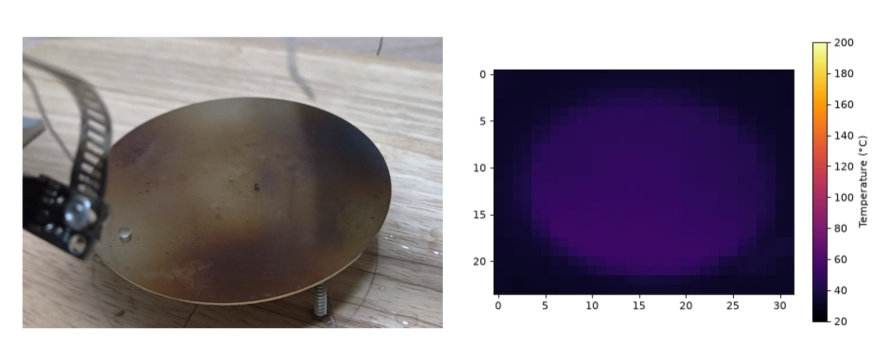

설치 후 열화상데이터를 시각화해보니 온도가 낮게 출력됨.
센서엔 80도로 찍히는데 만져보니 온도에 비해 너무 뜨거워서 이상해서 물방울을 떨어뜨려봤음. 
그랬더니 물방울이 굴러다니는 라이덴프로스트효과 발생…
실제로는 200도 이상이라는것임…

**표면 흑체화**

$$
E_{sensor}=\underbrace{ε⋅E(T_{plate})}_{\text{판 자신의 방출}}+\underbrace{(1−ε)⋅E(T_{ambient})}_{\text{주변의 반사}}
$$

적외선 영역에서 일반적인 물질은 전부 $$\varepsilon>0.9$$인 흑체임.
그런데 유일하게 그렇지 않은것이 바로 금속이고, 지금 SUS판은 0.1~0.3의 방사율을 가지고있기 때문에 $$\varepsilon=0.95$$로 설정된 적외선센서로 측정하면 온도가 엄청나게 잘못계산됨.

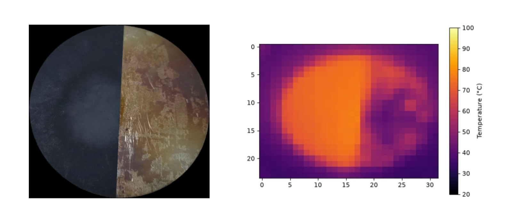

따라서 내열페인트로 흑체로 만들어줘야함…
실제로 대조실험을 통해 확인해본결과, 흑색코팅을 한 흑체일때와 아닐때 2배 이상의 차이가 나는것을 확인!

---

### 제어

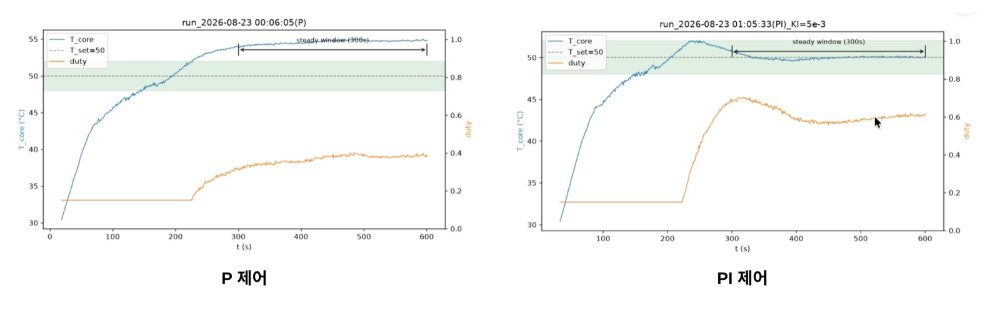

제어량은 웨이퍼의 평균온도, 조작량은 팬의 PWM duty로 설정함.
처음에 가장 간단한 비례제어를 구현했을때는, 온도제어테스트에서 정상상태오차가 5℃ 가량 발생했음.
따라서 PI제어로 수정하거나 상수항 bias 추가중 하나를 고민하다가, 별도의 튜닝없이 범용적으로 사용할수있는 PI제어를 선택했음.
그 결과 정확히 목표온도로 수렴하는 안정적인 제어성능을 달성했음.

참고로 이 온도제어장치는 시정수가 크고 느긋한 시스템이라서 PID 제어는 사용해봤자 노이즈에만 더 취약해지고 얻는 이점은 적을거라고 판단했음.

---

### AI 엔지니어링 어시스턴트

**사용하는 tools**

| 종류 | 역할 | 출력 |
| --- | --- | --- |
| `list_runs()` | "무슨 run들이 있어?" / "최근 run" 해석 | run id, 날짜, 길이, 제어타입, 파라미터 |
| `get_run_summary(run_id)` | "이 run 어땠어?" (개요) | 지속시간, T 시작/최종/min/max, duty 통계, setpoint |
| `analyze_control_performance(run_id)` | "제어 제대로 됐어?" | 정착시간, 오버슈트, 정상상태 오차(평균±std), ±2°C 밴드 체류율, duty 포화 비율 |
| `analyze_uniformity(run_id)` | "균일도 어땠어?" | T_std/T_max−T_min의 시간 추이 요약 (확장 로깅 필요) |
| `detect_anomalies(run_id)` | "이상한 구간 찾아줘" | 센서 드랍(n_core 급감), 시간 갭, 온도 스파이크 |
| `plot_run(run_id)` | “운전 시각화해줘” | 웨이퍼 평균온도 그래프 |

gpt-5.5 API 파이썬 스크립트를 이용해 운전데이터 분석을 도와주는 에이전트를 구현함.
AI가 직접 csv 데이터를 분석하면 부정확하고 비효율적이라서 상황에 맞는 tool을 호출하고 그 결과를 보고 사용자에게 답변하는 파이프라인으로 설계함.
tool들의 종류는 위와 같이 총 6개의 함수로 구성됨.

**tool 출력예시**

<details markdown="1">
<summary><code>analyze_control_performance(run_id)</code></summary>

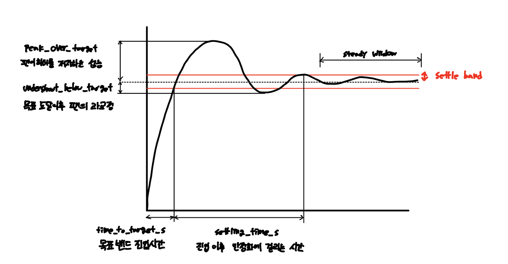

```json
{
	"run_id": "...",
	 "T_set": 75.0,
	 "reached_target": true, 
	 "time_to_target_s": 331.2, 
	 "settled": true, "settling_time_s": 168.7,
	 "overshoot_over_target_C": 2.16,
	 "undershoot_below_target_C": 1.23,
	 "steady_state_error_C": {"mean": 0.06, "std": 0.17}
}
```

</details>
    
<details markdown="1">
<summary><code>analyze_uniformity(run_id)</code></summary>

온도분포 간단한 통계 보여줌

```json
{
	"run_id": "run_2026-08-20 13:00:00", 
	"overall": {
							"T_std": {"mean": 2.52, "max": 2.75}, 
							"T_range": {"mean": 10.11, "max": 12.09}
							}, 
	"steady": {
							"T_std": {"mean": 2.68, "max": 2.7}, 
							"T_range": {"mean": 10.74, "max": 11.63}
							}
}
```

</details>
    
<details markdown="1">
<summary><code>detect_anomalies(run_id)</code></summary>

**① 시간 갭** — 샘플 간격이 **5초 이상** 벌어지면 비정상갭으로 판단.

**② 센서 드랍** — `n_core`가 비정상적으로 떨어진 구간. 카메라 가림/마스킹 실패 신호.<br>
400개를 정상적으로 보고, 정상적인 개수로 진입 이후 200밑으로 떨어진 구간을 비정상 판정.

**③ 온도 스파이크** — 연속 샘플 간 `|ΔT| > 3°C` 이상 벌어지면 비정상 온도스파이크

</details>
    
<details markdown="1">
<summary><code>plot_run(run_id)</code></summary>

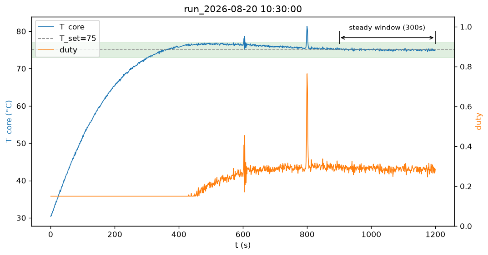

CSV를 읽고 제어량, 조작량을 plot으로 시각화해줌.

</details>
    

**에이전틱 파이프라인**

```
while True:
		# 사용자 프롬프트 작성
		input user prompt
		call LLM
		# LLM tool 반복호출 시 반복실행
    while LLM choice == "tool_calls":
		    exec toolcall
		    append toolcall results to context
		    call LLM
		# 응답출력
    print response
    append response to context
```

위의 pseudo code와 같이 매턴 사용자의 프롬프트를 받으면서도 context를 쌓으면서 여러턴에 걸쳐 stateful 하게 응답하도록 구현함. 
또한, tool 호출결과에 따라 후속 tool 호출을 반복할 수 있도록 에이전트 루프구조 구현.

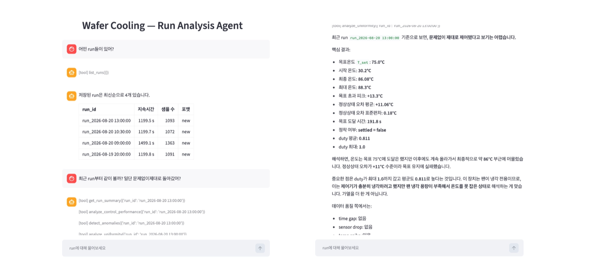

실행결과, tool 실행결과에 의거해 답변을 생성하므로 적대적이고 복잡한 질문들에서도 할루시네이션 없이 정확한 응답을 하는것을 확인할 수 있었음.

---
