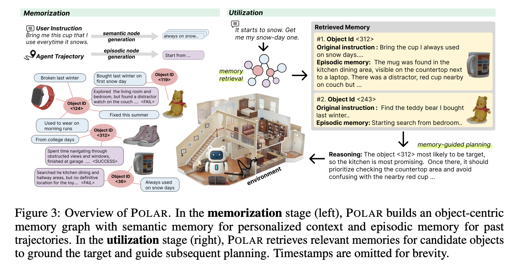
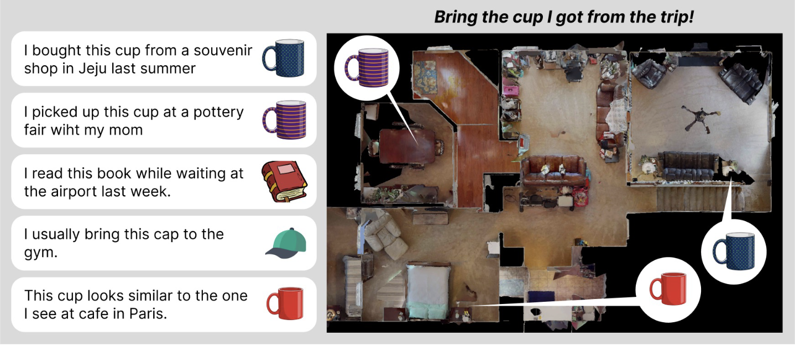
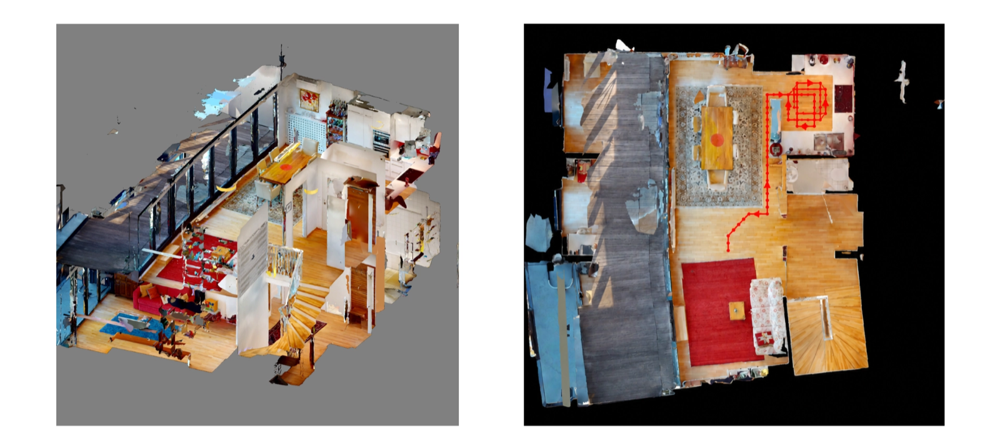
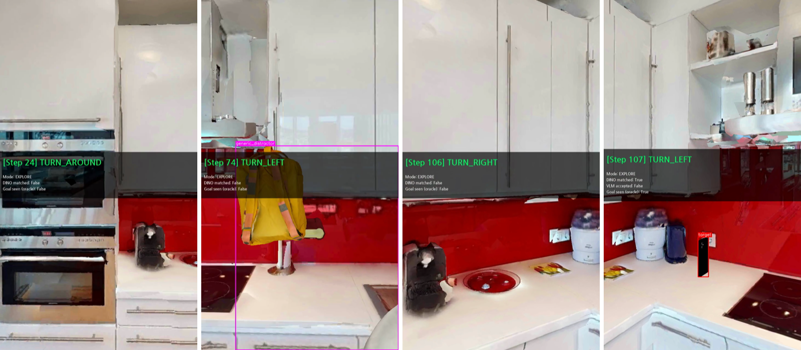
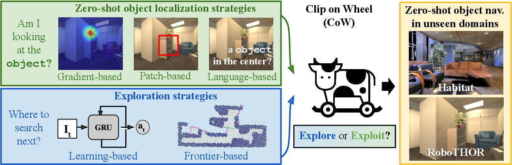
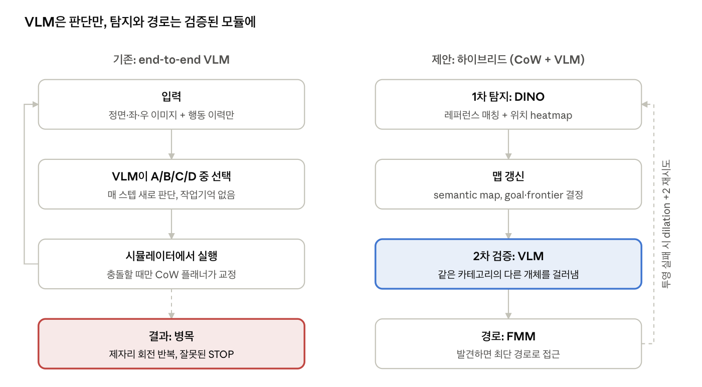
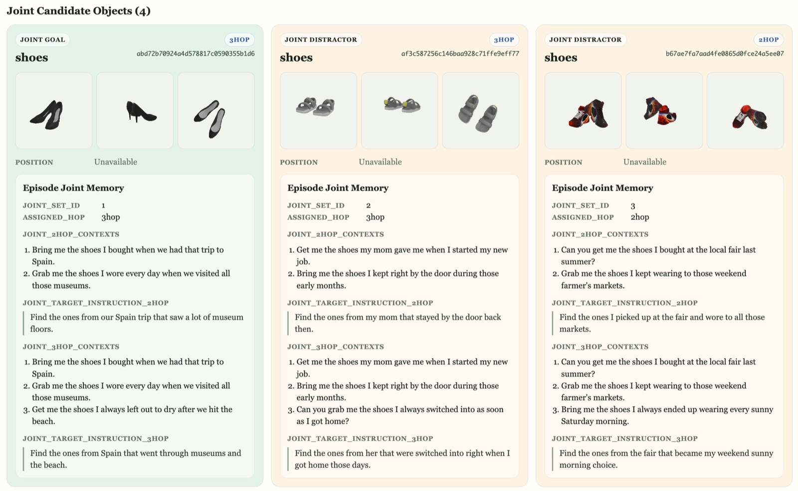

## 들어가며

2026년 4월부터 한 달간 개인화 에이전트 연구에 참여했다.
맡은 일은 개인화 embodied agent 연구의 에이전트 실험이었다.
이 연구는 이후 POLAR라는 이름으로 [arXiv에 공개](https://arxiv.org/abs/2605.26256)됐다.

한 달 동안 한 일을 한 줄로 줄이면 이렇다.
개인화 메모리의 효과를 보여주려고 실험을 돌렸는데, 그 전에 에이전트가 길부터 못 찾고 있었다.
그 병목을 진단하고 구조를 바꿔 본 것이 이 글의 중심이다.

미리 밝혀 두면, 코드와 실험 결과는 연구실 서버에 남아 있어서 이 글에는 정량 비교를 싣지 못했다.
대신 당시 남긴 메모와 실행 명령어, 렌더링 이미지를 바탕으로 무엇을 왜 했는지를 적는다.

## POLAR란?

POLAR는 네비게이션 task에서 쓸 수 있는 개인화 메모리모듈이다
집에 신발이 다섯 켤레 있다고 하자. 사용자가 "데이트할 때 신는 그 신발 가져와"라고 하면, 로봇은 "신발"이 아니라 "어느 신발"인지 알아야 한다. 그 단서는 지시문에 없고, 사용자와 나눈 과거 대화 어딘가에 있다.

기존 네비게이션 연구는 대부분 "신발로 가"처럼 카테고리 수준의 목표를 다루거나, 대상 사진을 직접 준다고 가정한다. POLAR는 그 대신 과거 상호작용을 기억으로 쌓아 두고 꺼내 쓰는 그래프기반 메모리 모듈이다.

- **환경**: 실제 집을 스캔한 HM3D 장면을 Habitat 시뮬레이터에 올리고, 같은 카테고리 물건들을 distractor로 뿌려 둔 PinNED 데이터셋을 썼다
- **에이전트**: MLLM이 정면·왼쪽·오른쪽 이미지를 보고 전진, 좌회전, 우회전, STOP 중 하나를 고른다
- **메모리**: 물건마다 node를 두고, 사용자 맥락("눈 오는 날 쓰는 컵")과 과거 탐색 경험("거실은 헛걸음이었다")또는 참조사진을 붙인다.



논문의 주요 contribution은 이 개인화 메모리 구조였고, 내가 맡은 쪽은 그 메모리를 쓸 에이전트와 실험이었다.

## 환경설정과정

연구원의 코드는 PIN 위에 구현돼 있었고, 별도의 가이드 문서 없이 코드를 넘겨받은 뒤 PIN 저장소의 Installation 절차를 따라 하면 된다는 안내를 받았다.
그런데 해보니 실제로는 재현성이 엉망인데다가 까다로운 로우레벨 의존성문제가 너무 많이 생겨서 초반은 거의 환경 설정에 썼다. 
코드는 CUDA 11.7을 기준으로 짜여 있었고, 연구실 컨테이너는 CUDA 12.1이었으며, 서버에는 화면이 없었다.

1. **habitat-sim 빌드**: ninja, libX11, libEGL, Xcursor, Xrandr, Xinerama, XInput2 헤더가 하나씩 차례로 없다고 떴다. 설치하고 다시 빌드하는 일을 일곱 번 반복했다.
2. **detectron2**: PyPI에 없어서 소스배포파일을 받아서 직접 빌드해야 했고, 빌드 스크립트가 torch를 import해서 `-no-build-isolation`이 필요했다.
3. **CUDA 불일치**: detectron2는 서버의 CUDA 12.1로 컴파일되는데, PyTorch는 11.7용 빌드를 내려받아서 충돌했다. 결국 PyTorch 2.1 + CUDA 12.1로 전체를 맞춰 해결했다.
4. **렌더링**: 화면 없는 서버에서는 EGL로 GPU 렌더링을 해야 하는데, EGL이 GPU를 못 찾았다. NVIDIA vendor 파일을 만들고, libstdc++를 올리고, habitat-sim을 headless로 다시 빌드하고, 아예 GLX + Xvfb 경로로 우회하는 것까지 해 봤다. 전부 실패했다.
5. **진짜 원인**: `ldd`로 실제 로딩되는 라이브러리를 보니, conda 환경 안에 따로 깔린 `libEGL`과 `libGLdispatch`가 시스템 것 대신 올라오고 있었다. 해결은 명령어 앞에 붙인 한 줄이었다.
    
    ```bash
    LD_PRELOAD=/lib/x86_64-linux-gnu/libEGL.so.1:/lib/x86_64-linux-gnu/libGLdispatch.so.0 \bash scripts/run_ours_eval_all_ours_jsons_parallel9.sh
    ```
    
    4번에서 한 시도 대부분은 필요 없었을지도 모른다.
    에러 메시지가 가리키는 설정을 고치기 전에, 실제로 어떤 파일이 로딩되는지부터 확인했어야 했다.
    

## 실험 돌리기



환경이 뜨고 나서는 코드베이스를 따라가며 흐름을 정리했다.
쉘 스크립트가 GPU 3장에 job 9개를 띄우고, 각 job이 에피소드를 나눠 맡는다.
Habitat이 장면을 렌더링하면 PIN 전용 센서가 대상 물건의 레퍼런스 이미지와 설명을 붙이고, 에이전트는 그걸 받아 행동을 고른다.

그 위에 실험에 필요한 것들을 구현했다.

- 결과 파일에 실제 이동거리 로깅을 추가해 SR과 함께 경로 효율을 따로 계산
- 에피소드별 통계 집계 스크립트, 매 스텝 렌더링에 MLLM의 추론을 주석으로 입히는 스크립트
- 시작할때 실행할 에피소드를 미리 분배하는것이 아니라 끝나면 워커가 에피소드를 하나씩 가져가는 큐 방식으로 바꾸어서 실행시간과 워커 활용률 최대화.
- 인스턴스가 겹치지 않는 100개 에피소드 커스텀 데이터셋 (18개 카테고리)

이후 다양한 세팅으로 실험을 진행했다.

| 축 | 바꿔 본 값 |
| --- | --- |
| MLLM 백본 | Qwen3-VL-8B, Llama-3.2-11B-Vision, Intern3-VL-9B, GPT API |
| 레퍼런스 이미지 | 없음 / 있음 |
| 방해 대화 수 | 0 / 4 / 9 / 14 / 19 |
| 에이전트 구조 | vanilla MLLM / 하이브리드 |
| 스텝 예산 | 100 / 300 / 1,000 |
| 데이터 규모 | 커스텀 100개 / scene 전체 약 5,000개, train / val |

## 기존 에이전트의 문제



실험의 목표는 단순했다. 
대상 물건 사진을 주면 성능이 크게 오른다는 걸 보여서, 개인화 기억이 필요하다는 당위성을 세우는 것이었다.
`Navigate the {category}`만 주는 조건과, 같은 지시문에 레퍼런스 이미지를 더 주는 조건을 비교했다.

그런데 앞서 구현한 추론과정 시각화 렌더링을 통해 에이전트의 trajectory들을 하나하나 뜯어보니, 에이전트가 같은 자리에 갇혀 맴돌고 있었다.
즉, 두 조건 모두 기초적인 navigation을 하지 못하는 상황이라 개인화 메모리 유무의 비교 자체가 의미가 없었다.

원인은 에이전트의 작동방식에 있었다.

```
Current task: navigate the teddy_bear
Action history: TURN LEFT, MOVE FORWARD, TURN RIGHT, ...

Choose exactly one action among:
- A = MOVE FORWARD
- B = TURN LEFT
- C = TURN RIGHT
- D = STOP

Image 1: front view
Image 2: left view
Image 3: right view

You are supposed to output in JSON. The output json format should be
  {{
    'visual_state_description':"...",
    'reasoning_and_reflection':"...",
    'action':"A|B|C|D",
  }}
```

간단히 나타내면 당시 에이전트는 이런식으로 작동했다.
MLLM에 매 스텝 지금 시야를 보여주고, 전진/좌/우/정지 중 하나의 action을 선택하는 에이전트였다. 



이 구조에서 가장 심각한것은, 에이전트의 작업기억이 사실상 없는상태에서 MLLM에 매 턴 기계적인 action을 출력하도록 한다는 것이었다.

특히 기존 에이전트는 PIN 코드베이스 위에 추가적인 구현을 해둔 상태였는데, 벽에 부딪히거나 하는 상황에서는 환경이 강제로 선택된 action과 다르게 움직이도록 되어있어 이전 action들의 history를 참고한 MLLM이 계속 동일하게 움직이고 끼는 문제가 발생했다.

또한 MLLM이 자연어로 출력하는 "안 가본 방으로 가자"(exploration)도, "아까 본 그걸로 다가가자"(exploitation)는 고차원적인 추론은 전진/좌/우/정지같은 low level action과는 잘 매칭이 되지 않았다.
저러한 고차원적인 목표는 일련의 low level action들의 시리즈로 분해되어야하는데, 매턴 고차원적인 추론 후 저차원적인 action을 선택하는 방식의 구조적인 문제라고 판단했다.

개인화 맥락을 아무리 잘 넣어줘도, 그걸 쓸 에이전트가 길을 못 찾으면 효과를 입증할수가 없었다. 
그래서 에이전트 구조부터 손보기로 했다.

## 하이브리드 에이전트: MLLM에게 판단만 맡기기



선행 연구인 PIN에는 CoW(CLIP on Wheels)라는 모듈형 베이스라인이 있다. 
탐지는 DINO·CLIP 같은 비전 모델이, 탐색은 안 가본 경계로 가는 Frontier-Based Exploration(FBE)이, 접근은 최단경로를 계산하는 Fast Marching Method(FMM)가 맡는다. 
FMM은 목표만 찾으면 경로가 최적이라는 게 보장된다.

그래서 CoW에 MLLM을 통합해서 MLLM을 쓰는 의미는 살리되, 최소한의 에이전트 성능은 달성하자고 제안했다.

- **탐지**: DINO가 레퍼런스와 매칭해 후보를 찾고, heatmap으로 위치까지 낸다. 
다만 DINO는 같은 카테고리의 다른 개체를 잘 못 가르므로, MLLM이 2차로 "정말 그 물건인가"를 검증한다.
- **탐색**: FBE는 맹목적으로 안 가본 곳으로 간다. 여기를 MLLM이 의미 기반으로 정하면 "책을 찾으니 화장실보다 서재로" 같은 판단이 가능해진다
- **접근**: FMM은 그대로 둔다

에이전트의 한 스텝은 이런 루프로 구현했다.

```python
while extra_dilation < 200:
    try:
        obs_preprocessor.preprocess()   # DINO 매칭 + heatmap
        _prepare_planner_inputs()       # semantic map 갱신, FBM/FMM(goal/frontier) 결정
        vlm_verify()                    # DINO가 매칭했으면 MLLM이 검증
        planner.plan()                  # 행동 결정
    except ValueError:                  # 목표는 찾았는데 맵 투영에 실패 → dilation을 키워 재시도
        extra_dilation += 2
        continue
    break
```



구현한 에이전트를 돌려 보니, SPL이 기존 0.07에서 수정된 모델은 0.28로 올라 기존의 vanilla MLLM기반 에이전트보다 훨씬 나아진 결과를 확인할 수 있었다. 

## 대화맥락 방해 실험

두 번째 실험도 목표는 동일했다. 여기서는 장기 맥락 문제를 겨냥했다. 
레퍼런스를 먼저 보여주고, 그 뒤에 다른 물건과 관련된 대화를 여러 개 끼워 넣은 후 진짜 지시를 준다.

```
[레퍼런스] find my cellphone + 사진
[방해 1]  find my backpack + 사진
[방해 2]  find my bag + 사진
...
[최종]    navigate the cellphone + 정면/좌/우 이미지
```

방해 대화 수를 늘려 가며 MLLM이 언제부터 헷갈리는지 보는 실험이다. 
같은 구조는 최종 논문의 예비실험(0-turn vs 10-turn)에도 들어갔다.

MLLM은 연구실 서버(A6000 클러스터)에서 vLLM 으로 호스팅하고 에이전트가 API형식으로 추론을 사용하는 형식이었는데, 이미지 수가 여러개로 늘어남에 따라 Prefill 단계의 시간이 크게 늘어 실험이 느려졌다.
특히 Llama 같은 경우는 애초에 이미지를 1개만 넣도록 권장되어있었고, 억지로 더 넣게되면 성능이 떨어지다가 context window가 초과되었었다.

초기에는 방해 대화를 코드에서 하드코딩으로 섞었고, 이후 전용 데이터셋 파일에서 읽도록 바뀌었다. 
그런데 실행할 때 `DATASET_PATH`에는 그 전용 데이터셋이 들어가지 않고 있었다. 
프롬프트 속 방해 물건과 실제로 배치된 물건이 서로 다른 채로 실험이 돌고 있었던 것이다. 
에러는 하나도 나지 않아서, 결과만 봤다면 모르고 지나갔을 버그였다.

결과적으로는 방해용 대화를 끼워넣어 맥락을 어지럽혔을때, 어느정도의 성능향상을 관찰할 수 있었다.

## 데이터셋 검수



다음으로는 목표물체 데이터셋 검수를 진행했음.
데이터셋은 크게 compositional, distractor, temporal 형으로 나누어지며, 모두 지식그래프형태의 POLAR가 기존 MLLM의 약점을 잘 커버하는것을 보여주기 위한 유형들임.

먼저 compositional은 여러 턴의 대화를 고려하고 조합해야 실제로 사용자가 지칭하는 개체를 특정할 수 있는 케이스임.
POLAR는 개체 node에 여러가지 관련 기억을 담은 의미론적 node들이 붙어있으므로 정보가 여러턴의 대화에 나누어져 있어도 검색하기 좋게 구성되어있어 이런 task에서 MLLM에 비해 훨씬 유리했다.

둘째 distractor의 경우는, HM3D 환경에 정답과 동일한 카테고리의 개체들을 많이 배치해두어 개체를 정확히 특정하지 못하면 비슷한유형의 물체들을 고르게되는 세팅이었다.
compositional과 마찬가지로, 개체 하나에 여러 node들이 붙어있는 POLAR의 유용함을 보여주기 좋았다.

마지막 temporal 같은경우는 정보에 대한 시간적 고려가 필요한 케이스이다.
이 케이스는 앞선 경우들과 달리 그래프의 node가 아니라 edge의 타임스탬프를 이용하는 유형으로, 그래프구조의 메모리모듈이 각 기억들의 시간적 관계를 효과적으로 관리할수 있는점을 보여줄 수 있었다.

데이터셋들에 들어가는 각 물체들의 지시문과 맥락들은 프론티어모델(GPT)를 이용해 합성됐는데, 대부분 문제가 없었으나 temporal 케이스의 경우는 주어진 정보만으로는 정확히 개체를 특정할수 없는 문제들이 많아서 일부 수정이 필요했었다.
